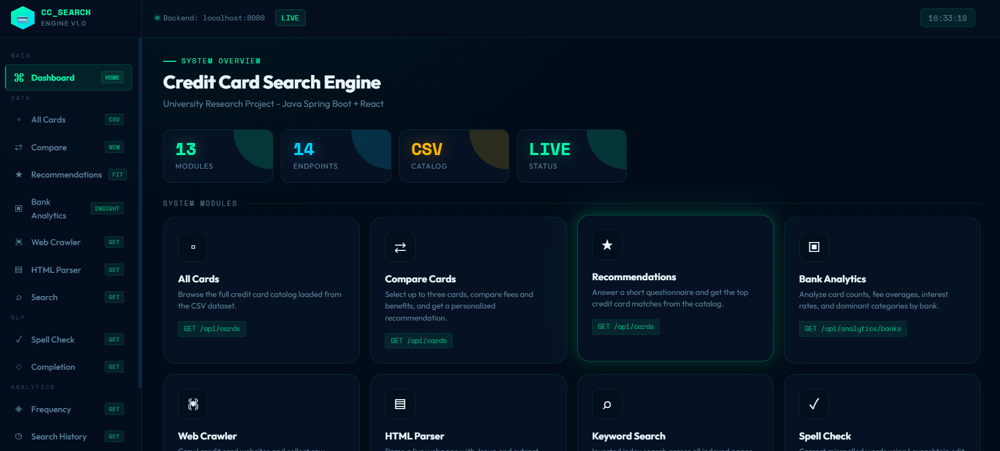

# Credit Card Comparison & Web Search Engine

A university group project: a Spring Boot web application that crawls bank credit card pages, counts keyword frequency, tracks search history and shows the results in a React dashboard.




## What it does

- Crawls bank credit card pages with Selenium and ChromeDriver.
- Counts how often a keyword appears across the crawled pages.
- Tracks search history, which fills in after frequency and search requests.
- Shows the results in a React dashboard backed by the Spring Boot API.

## Tech stack

| Part | Technology |
|---|---|
| Backend | Java 21, Spring Boot, Maven |
| Frontend | React with Vite |
| Crawling | Selenium and ChromeDriver |

## Project structure

```text
├── src/main/java/com/creditcard/comparison/
│   ├── config/
│   ├── controller/
│   ├── crawler/
│   ├── index/
│   ├── model/
│   ├── parser/
│   ├── recommendation/
│   ├── spellcheck/
│   └── util/
├── src/main/resources/
│   ├── application.properties
│   └── static/frontend/      # React + Vite app
├── data/
├── pom.xml
└── README.md
```

## Requirements

- Java JDK 21 or newer
- Maven 3.9 or newer
- Node.js 18 or newer
- Git
- Google Chrome and a matching ChromeDriver

Check your versions:

```powershell
java -version
mvn -version
node -v
npm -v
```

## ChromeDriver setup

The crawler expects ChromeDriver at a fixed Windows path:

```java
System.setProperty("webdriver.chrome.driver", "C:\\chromedriver\\chromedriver.exe");
```

1. Install a ChromeDriver version that matches your Chrome.
2. Put `chromedriver.exe` in `C:\chromedriver\`.

If yours lives elsewhere, change the path in `src/main/java/com/creditcard/comparison/crawler/WebCrawler.java`.

## Install

```powershell
git clone https://github.com/bhavyapatel0201/Credit-Card-Comparison-Analysis.git
cd Credit-Card-Comparison-Analysis

# Backend
mvn clean install

# Frontend
cd src\main\resources\static\frontend
npm install
cd ..\..\..\..\..
```

## Run

You need two terminals.

**Terminal 1, backend** (from the project root):

```powershell
mvn spring-boot:run
```

The API runs on `http://localhost:8080`.

**Terminal 2, frontend:**

```powershell
cd src\main\resources\static\frontend
npm run dev
```

The dashboard usually opens on `http://localhost:3000`. If Vite picks another port, use the URL it prints.

## How to use it

1. Start the backend and the frontend.
2. Open the dashboard in your browser.
3. Run the crawler first.
4. Then try the frequency and search history features.

The frequency counter depends on crawled page content, and search history is filled in after frequency and search requests.

## API endpoints

```text
GET  /api/test
GET  /api/crawl?banks=RBC
GET  /api/frequency?word=cashback
GET  /api/search-frequency
```

Example: `http://localhost:8080/api/frequency?word=cashback`

## Troubleshooting

- **404 on frequency or search history:** restart the backend (`mvn spring-boot:run`) after pulling the latest code.
- **"Failed to fetch" in the dashboard:** check that the backend is running on `localhost:8080`, the frontend is running, and no old backend instance is still open.
- **ChromeDriver error:** check that `chromedriver.exe` exists at the configured path and that its version matches your Chrome.

## Contributors

Built as a group project. See the [team repository](https://github.com/pruthvi4344/Credit-Card-Comparison-Analysis-) for the full contributor list.